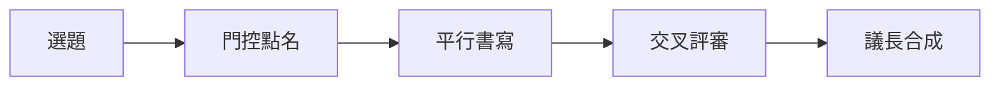

<div align="center">

# grok-council

門控選席，平行作答，交叉評審，議長合成。不填 Key，也能看見八張卡片在寫。

Gate, parallel answers, cross-review, chair. No key required to watch eight cards write.

<p>
  <a href="https://web3-ai-game.github.io/grok-council/"></a>
  <a href="https://github.com/web3-ai-game/system-design-portfolio"></a>
  <a href="LICENSE"></a>
</p>

[線上回放](https://web3-ai-game.github.io/grok-council/) · [作品集](https://portfolio.oece-x.com) · [架構說明](https://github.com/web3-ai-game/system-design-portfolio)

</div>

## 繁體中文

八席：分析師、情報官、工程師、紅隊、策略家、表達者、量化員、議長。門控不必每次叫醒全部。棋盤仍是 4×2。被跳過的席留在格子裡，標 `STANDBY · 門控跳過（省 Token）`。

```text
選題 → 門控點名 → 醒著的席平行書寫 → 交叉評審互怼 → 議長合成
```



三個回放：

| 議題 | 門控 |
|---|---|
| 鑰匙邊界 | 7 席 + 議長 |
| 可見 vs 黑盒 | 5 席 + 議長，情報官與表達者跳過 |
| 單機天花板 | 7 席 + 議長 |

這是策展回放，不是某次實扣。公開頁不持有 Key。

### 網頁

打開 [Live Replay Sandbox](https://web3-ai-game.github.io/grok-council/)。右上角可以切 `EN / 繁`，也可以開關燈。關燈是暖炭色，開燈是奶油紙色，光從開關處攤開。

### 本地 `--demo`

不需要 Key。

```bash
cd frontend
npm install
npm run dev:demo
```

另開一個終端，若要走同一份 JSON 的 SSE：

```bash
cd backend
python3 -m venv .venv
.venv/bin/pip install -r requirements.txt
.venv/bin/python -m app --demo
```

`GET /api/demo/scenarios` 與 `GET /api/demo/play?id=key-boundary&lang=zh`。生成接口仍要登入和 Key。`--demo` 不開放那條路。

自用、要打上游時，另設 `XAI_API_KEY`，不要把 Key 放進這個樹。

## English

Eight seats: Analyst, Intel, Systems Engineer, Red Team, Strategist, Communicator, Quant, Chair. The gate does not have to wake all of them. The board stays 4×2. A skipped seat remains on the grid as `STANDBY · Gate skipped`.

```text
Pick → Gate names seats → Awake seats write in parallel → Cross-review → Chair synthesizes
```

Three replays ship with the tree. Key boundary and the single-node ceiling wake seven seats plus the chair. Visible-versus-black-box wakes five plus the chair, and leaves Intel and the Communicator on standby. These are curated tapes, not a live capture. The public page holds no key.

The [live replay](https://web3-ai-game.github.io/grok-council/) has an `EN / 繁` switch and a lamp. Lights off is warm charcoal. Lights on is cream paper. The change opens from the switch.

Local replay, no key:

```bash
cd frontend
npm install
npm run dev:demo
```

Optional SSE from the same JSON:

```bash
cd backend
python3 -m venv .venv
.venv/bin/pip install -r requirements.txt
.venv/bin/python -m app --demo
```

Bring your own key only if you run the live client. Do not commit it.

JetBrains Mono is bundled under the SIL Open Font License. See `frontend/src/fonts/OFL.txt`.
